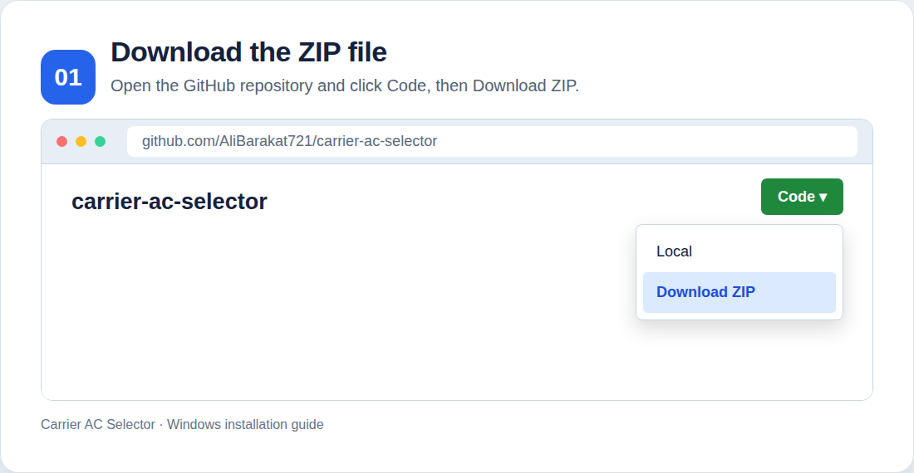
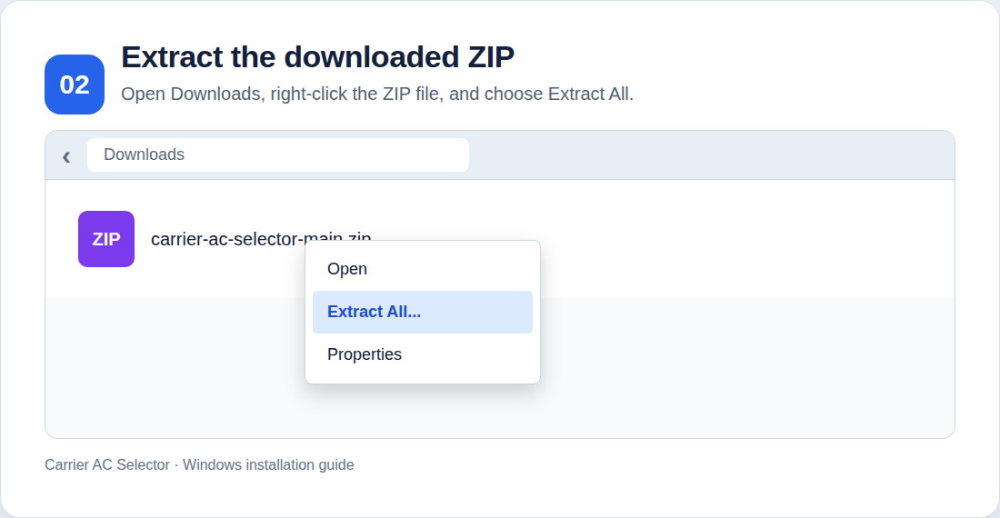
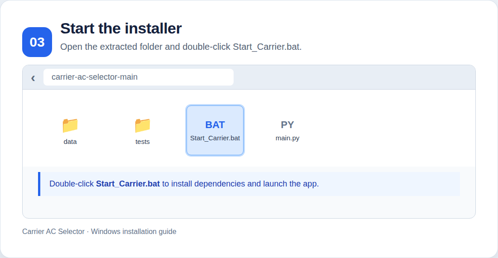

# Carrier AC Selector — HAP Report Analyzer

Desktop tool built with PySide6 that reads a HAP *Air System Sizing Summary* screenshot, PDF, or RTF report, extracts the cooling load and coil airflow, and filters the Carrier AC catalogue for matching indoor/outdoor combinations.

## Features

- **Input:** PNG / JPG / TIFF / PDF / RTF.
- **PDF handling:** native PDF text is used first; scanned PDFs and images use Tesseract OCR.
- **HAP parsing:** extracts total coil load in MBH and coil CFM, with explicit warnings when a value cannot be read.
- **Multi-system reports:** detects both `Air System Information ... Air System Name ...` and `Air System Sizing Summary for ...` layouts, including mixed reports.
- **Selection controls:** safety factor, derating, CFM coverage, sensible-load check, Category / Type / Series / Power Supply filters.
- **Multi-unit selection:** suggests the minimum number of identical units, up to four, when one unit cannot cover the load.
- **Best-unit picker:** balanced score, least oversized, highest EER, and best airflow fit.
- **Selection cart:** collect units for multiple systems and export them together.
- **Electrical schedule:** estimated FLA, breaker, cable sizing, voltage drop, feeder, panel, generator, and UPS values.
- **Inverter ROI:** energy, cost, payback, lifecycle, and CO₂ comparison.
- **Export:** Excel, CSV, and formatted Word reports.
- **UI:** dark PySide6 interface, background OCR worker, image/PDF preview, and OCR debug tab.

## Requirements

- Python 3.10 or newer.
- Linux, macOS, or Windows with a working PySide6 installation.
- **Tesseract OCR** is required only for image input and scanned PDFs. RTF files and PDFs with a text layer do not require it.

### Install Tesseract

Ubuntu/Debian:

```bash
sudo apt update
sudo apt install -y tesseract-ocr
```

Fedora/RHEL:

```bash
sudo dnf install -y tesseract tesseract-langpack-eng
```

macOS:

```bash
brew install tesseract
```

On Windows, install Tesseract using the UB Mannheim installer and add its installation directory (commonly `C:\\Program Files\\Tesseract-OCR`) to `PATH`. Restart PowerShell after changing `PATH`.

## Install

### Windows — easiest method for non-technical users

1. Download the repository using **Code → Download ZIP**, then extract the ZIP file.
2. Install Python 3.10 or newer from https://www.python.org/downloads/windows/ and enable **Add Python to PATH** during installation.
3. Open the extracted project folder and double-click **Start_Carrier.bat**.
4. On the first launch, the launcher creates the Windows virtual environment, verifies the required Python packages, and creates a **Carrier AC Selector** shortcut on the Desktop when Windows allows it.
5. After setup finishes, the application starts. For future use, double-click the **Carrier AC Selector** icon on the Desktop. You can also double-click `Start_Carrier.bat` inside the project folder.

Keep the extracted project folder in its original location after setup. The Desktop shortcut points to that folder, so moving or deleting it will break the shortcut. An internet connection is required for the first-time package installation. If Windows blocks shortcut creation, the application can still be started with `Start_Carrier.bat` or `run.ps1`.

### Windows installation walkthrough

Follow these steps if you downloaded the project as a ZIP file:

#### 1. Download the project from GitHub

Open the repository page, click **Code**, and select **Download ZIP**. Save the ZIP file to your computer, usually in the Downloads folder.



#### 2. Extract the ZIP file

Open the Downloads folder, right-click `carrier-ac-selector-main.zip`, choose **Extract All...**, and select a permanent folder. Do not run the program from inside the ZIP preview.



#### 3. Install Python

If Python is not already installed, download Python 3.10 or newer from the [official Windows download page](https://www.python.org/downloads/windows/). During installation, enable **Add Python to PATH**.

#### 4. Start the automatic installer

Open the extracted `carrier-ac-selector-main` folder and double-click `Start_Carrier.bat`. The first run creates `.venv`, installs the Python packages, checks the installation, and starts the application. Keep the computer connected to the internet during this step.



#### 5. Use the Desktop shortcut

When setup succeeds, Windows creates a **Carrier AC Selector** shortcut on the Desktop. Keep the extracted project folder in place because the shortcut uses that folder as the application working directory.

If Windows cannot create the shortcut, this does not prevent the application from working. Run `Start_Carrier.bat` again or use `run.ps1` from PowerShell.

#### 6. Optional OCR setup

Tesseract OCR is only needed for image files and scanned PDFs. RTF files and PDFs that already contain selectable text do not require Tesseract. See [Install Tesseract](#install-tesseract) above for the Windows setup note.

### Windows (PowerShell)

Open PowerShell in the project directory:

```powershell
Set-ExecutionPolicy -Scope Process -ExecutionPolicy Bypass
.\\setup.ps1
```

The script creates a Windows-specific `.venv\\` and installs all runtime and test dependencies. Then run:

```powershell
.\\run.ps1
```

To execute tests on Windows:

```powershell
.\\test.ps1
```

If PowerShell blocks scripts, the `Set-ExecutionPolicy` command above changes the policy only for the current PowerShell process.

### Linux / macOS

From the project directory:

```bash
./setup.sh
```

The script creates `.venv/`, installs runtime dependencies from `requirements.txt`, and installs test/development dependencies from `requirements-dev.txt`.

To install manually:

```bash
python3 -m venv .venv
. .venv/bin/activate
python -m pip install --upgrade pip
python -m pip install -r requirements.txt -r requirements-dev.txt
```

## Run

```bash
./run.sh
```

The script activates `.venv` and starts the PySide6 application. To run manually:

```bash
. .venv/bin/activate
python main.py
```

## Test

```bash
./test.sh
```

The test script runs the available unit tests with `pytest`. It also performs a Python bytecode compilation check for the application modules.

To run tests manually:

```bash
. .venv/bin/activate
pytest -q
python -m py_compile core.py main.py electrical_engine.py ocr_engine.py roi_tab.py
```

The current regression suite covers database-independent HAP parsing, including multi-system `Sizing Summary` headers, the legacy information layout, mixed layouts, and system names without digits.

## Project layout

```text
core.py                       Pure logic: database loading, HAP parsing, selection
ocr_engine.py                 OCR front-end: RTF/PDF text layer/Tesseract
main.py                       PySide6 GUI and report export
electrical_engine.py          Electrical load and cable-sizing calculations
roi_tab.py                    Inverter ROI calculations and export helpers
data/Carrier_AC_Database.xlsx Carrier catalogue

tests/test_core.py            Parser regression tests
setup.sh                      Create the virtual environment and install dependencies
run.sh                        Activate the environment and start the GUI
test.sh                        Run tests and syntax checks
setup.ps1                     Create the Windows virtual environment and install dependencies
run.ps1                       Start the GUI using the Windows virtual environment
test.ps1                      Run tests and syntax checks on Windows
requirements.txt              Runtime dependencies
requirements-dev.txt          Test/development dependencies
```

## Adding a new AC model

1. Open `data/Carrier_AC_Database.xlsx`.
2. Add a row with the required catalogue columns. Column order does not matter; columns are matched by name.
3. If the same `System Model` appears more than once, the loader merges the entries and joins their series.
4. Blank or em-dash heating values are treated as not applicable.
5. Values prefixed with `≈` are accepted and marked as approximate where applicable.

## Notes

- The electrical schedule is an engineering estimate and must be reviewed against the applicable local electrical code and project design data.
- Tesseract is an external system package; installing the Python package `pytesseract` alone is not enough for image OCR.
- A Python `.venv` is operating-system-specific. Create it separately on Windows with `setup.ps1`; do not copy the Linux `.venv` into Windows or commit either environment.
- Windows and Linux are both covered by the GitHub Actions test matrix. The automated checks validate dependency imports, Python compilation, and unit tests; OCR with the external Tesseract executable still requires a local Windows installation and a real scanned-file test.
- Generated Excel, Word, virtual-environment, cache, and temporary files are excluded by `.gitignore` where appropriate.
